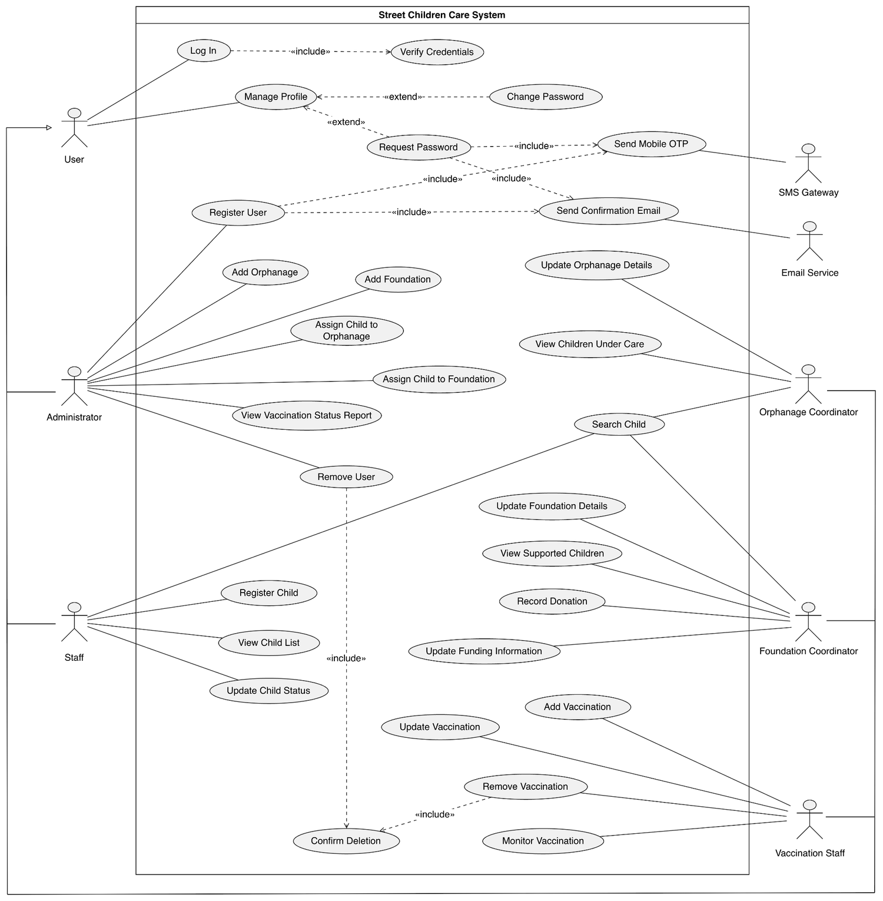
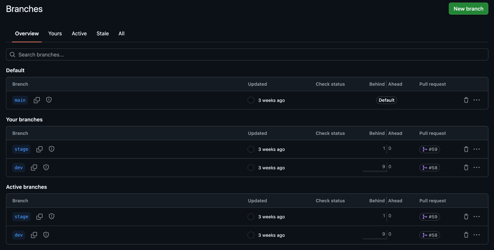
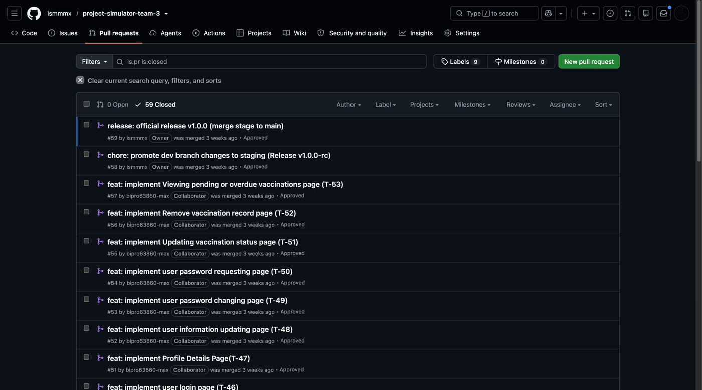

# Street Children Care System

**A role-based desktop management system for street children care, developed by a five-member team using the Agile / Extreme Programming (XP) model.**


Street children's records in Bangladesh are often scattered across paper files kept by separate orphanages, foundations and health workers. The **Street Children Care System (SCCS)** is a role-based desktop application that centralizes child registration, orphanage/foundation coordination and vaccination tracking in one SQL Server database, built by a five-person team under the Agile/XP process.

**Quick links:** [Project Report (PDF)](docs/project-report/Street-Children-Care-System-Project-Report.pdf) · [Figma UI/UX Design](https://www.figma.com/design/SAj49Efd8CGjBv6D91nNh9/Street_Children_Care_System?node-id=9-36) · [Trello Board](https://trello.com/b/yeTZYjen/street-children-care-system) · [Documentation Index](docs/README.md)

---

## 📑 Table of Contents

- [Overview](#-overview)
- [Problem Statement](#-problem-statement)
- [Objectives](#-objectives)
- [User Roles](#-user-roles)
- [Key Features](#-key-features)
- [Use Case Model](#-use-case-model)
- [Tech Stack](#️-tech-stack)
- [Development Methodology](#-development-methodology)
- [Git Workflow](#-git-workflow)
- [UI/UX Design](#-uiux-design)
- [Testing](#-testing)
- [Project Management](#-project-management)
- [How to Use This Repository](#-how-to-use-this-repository)
- [Repository Structure](#-repository-structure)
- [Documentation](#-documentation)
- [Team and Contributions](#-team-and-contributions)
- [My Contribution](#-my-contribution)
- [Known Limitations](#-known-limitations-and-planned-repository-improvements)
- [Academic Context](#-academic-context)
- [Contributing](#-contributing)
- [License](#-license)
- [Contact and Acknowledgements](#-contact-and-acknowledgements)

---

## 🔍 Overview

In Bangladesh, organizations that support street children — orphanages, NGOs and charitable foundations — often rely on paper-based, scattered records. This leads to duplicate entries, lost files, missed vaccination dates and no reliable control over who can see sensitive child information.

The **Street Children Care System (SCCS)** proposes a single, centralized desktop application that links **children, orphanages, foundations and vaccination records** in one database, with **role-based access** so that each user sees only the data relevant to their role. The system is designed with a **C# Windows Forms** front end and a **SQL Server** back end.

This repository is the public record of the team's software engineering work: requirements specification, user stories, use case model, Figma UI/UX design, test cases, and the Git/Trello workflow used to manage development under Agile / XP.

> **Repository scope.** This repository contains the project documentation, design artefacts, and development-workflow evidence (Git history, pull requests, Trello board). The C# Windows Forms source code and SQL Server scripts are **not included in this repository at this time**. Implementation progress is tracked task by task in [`docs/requirements/implemented-features.md`](docs/requirements/implemented-features.md).

> **Data notice.** The project concerns sensitive information about children. All names, IDs, contact details and figures shown in the designs and test cases are illustrative sample data. No real child records are stored in this repository.

## ❗ Problem Statement

Paper-based record keeping in child-care organizations causes:

- No real control over who can access sensitive child records
- Missed vaccination dates
- Duplicate entries and conflicting records across offices
- Lost records and slow tracing of a child's orphanage, foundation or vaccination status

There is no single system that connects children, orphanages, foundations and health records.

## 🎯 Objectives

- Provide one centralized system to register street children and connect them to orphanages and foundations.
- Track vaccination history and status (pending, completed, overdue).
- Enforce role-based access so each user works only with the data relevant to their role.
- Reduce data loss, duplication and human error compared with paper records.

## 👥 User Roles

| Role | Responsibility |
|---|---|
| **Administrator** | Manages user accounts and roles, registers partner orphanages and foundations, assigns children to organizations, reviews vaccination reports. |
| **Staff** | Registers street children, updates personal details and placement status, searches and filters child records. |
| **Orphanage Coordinator** | Maintains orphanage information (name, location, capacity, contact) and tracks children under the orphanage's care. |
| **Foundation Coordinator** | Maintains foundation details, views supported children, records donations and funding information. |
| **Vaccination Staff** | Adds and updates vaccination records, manages vaccination status, lists children with pending or overdue vaccinations. |

## 🚀 Key Features

The requirements are organized into 11 scopes (full detail in the [project report](docs/project-report/Street-Children-Care-System-Project-Report.pdf) and [requirements summary](docs/requirements/README.md)):

1. **User authentication and access management** — five predefined roles; username/password login; registration verified by mobile OTP and confirmation email.
2. **Account enrollment and provisioning** — administrators create, edit and remove user accounts.
3. **Self-profile and credential management** — profile view/edit, password change, and OTP-based password recovery.
4. **Street child registration** — demographic data, estimated age, gender, location, initial physical condition, with required-field validation.
5. **Child case management and tracking** — master child list with search and filtering by name, age and care status.
6. **Orphanage partner management** — administrators add, view and edit partner orphanages.
7. **Orphanage care coordination** — orphanage profile and the list of children in the orphanage.
8. **Foundation partner management** — administrators add, view and edit partner foundations.
9. **Foundation support coordination** — foundation details, supported children, donation and funding records.
10. **Health and immunization records** — vaccine, dose and date per child; automatic pending/completed/overdue status.
11. **Health drive scheduling and monitoring** — lists of children with pending or overdue vaccinations to plan field visits.

**Non-functional requirements** cover security and access control, data integrity (centralized SQL Server database, confirmation before deletion), usability (familiar Windows Forms interface, instant status updates, success notifications) and performance (fast child search, role-filtered dashboards).

## 🗺️ Use Case Model



*Figure 1 — Use case diagram showing the five user roles and the external SMS gateway and email service actors.*

## 🛠️ Tech Stack

| Area | Technology |
|---|---|
| Front end | C# Windows Forms (desktop application) |
| Back end / database | Microsoft SQL Server |
| UI/UX design | Figma |
| Modeling | UML use case diagram |
| Version control | Git and GitHub (branches, pull requests, code review) |
| Project management | Trello |
| Documentation | Shared Google Workspace documents |

## 🔄 Development Methodology

The team followed the **Agile – Extreme Programming (XP)** process model, working in **weekly iterations**. The project report describes these phases:

| Phase | Activity in this project |
|---|---|
| Exploration | Identified problems with manual record keeping, defined boundaries for the five roles, chose the technology stack. |
| Planning | Wrote user stories for all five roles, set iteration goals, created the Trello board. |
| Iterations to Release | Weekly iterations; each member developed on their own branch and opened a pull request for team review before merging. |
| Productionizing | Integrated system testing of data connections, role-based access and data accuracy. |
| Maintenance | UI adjustments, bug fixes and database updates as needs change. |
| Death | Project closure with full documentation and hand-off. |

**XP practices applied:** weekly iterations and small releases · Trello task tracking · pull-request code review · collective code ownership and continuous integration · flexibility for changing requirements · sustainable pace (maximum 40 working hours per week) · team communication.

## 🌿 Git Workflow

- Central repository on GitHub with three long-lived branches: `main` (stable), `stage` (pre-release) and `dev` (integration).
- Task work was done on short-lived branches, merged through pull requests, and commit/PR titles reference Trello task IDs, for example `feat: implement user login page (T-46)`.
- Release flow: `dev` → `stage` (release candidate, PR #58) → `main` (official release v1.0.0, PR #59).
- 59 pull requests were opened and closed during development; 0 remain open.

| Branches | Pull requests |
|---|---|
|  |  |

*Evidence captured for the project report, before the repository was renamed and reorganized. See [Project Management](docs/project-management/README.md) for the network graph and contributor statistics.*

See [`CONTRIBUTING.md`](CONTRIBUTING.md) for the branch naming and commit-message conventions used going forward.

## 🎨 UI/UX Design

The interface was designed in **Figma** as a dark-themed desktop UI with a persistent sidebar and role-specific dashboards. The prototype covers 16 screens across all five roles.

**Figma project:** [Street_Children_Care_System](https://www.figma.com/design/SAj49Efd8CGjBv6D91nNh9/Street_Children_Care_System?node-id=9-36)

> These images are **design prototype screens exported from Figma**, not screenshots of the running application. The full set of 16 screens is listed in the [UI/UX design index](docs/design/README.md).

<table>
  <tr>
    <td width="50%"><br><sub><b>Login</b> — role-based sign-in with password recovery link</sub></td>
    <td width="50%"><br><sub><b>Administrator: User Management</b> — searchable list of system users and roles</sub></td>
  </tr>
  <tr>
    <td width="50%"><br><sub><b>Administrator: Child Placement &amp; Tracking</b> — assign children to organizations</sub></td>
    <td width="50%"><br><sub><b>Staff: New Child Registration</b> — required-field child registration form</sub></td>
  </tr>
  <tr>
    <td width="50%"><br><sub><b>Foundation Coordinator: Finance Management</b> — donations and transaction history</sub></td>
    <td width="50%"><br><sub><b>Vaccination Staff: Vaccination Record</b> — search and review child vaccination records</sub></td>
  </tr>
</table>

## ✅ Testing

Four manual test cases were designed and executed by four different team members. Three passed and one failed; the failure is documented openly as a known issue.

| ID | Module | Scenario | Result |
|---|---|---|---|
| TC_1 | Child Placement & Tracking | Administrator assigns an unassigned child to a registered orphanage | Pass |
| TC_2 | Foundation Profile | Foundation Coordinator updates profile with valid data | Pass |
| TC_3 | New Child Registration | Staff registers a new child with complete valid details | Pass |
| TC_4 | Orphanage Profile Details | Non-numeric text entered in the *Max Capacity* field | **Fail** — form was submitted without validation |

Details: [`docs/testing/README.md`](docs/testing/README.md)

## 📋 Project Management

Tasks were managed on Trello using user-story lists (*As A/An*, *I want to*, *So that*, *Acceptance Criteria*) and workflow lists (*In Progress*, *In Review*, *Done*). The board snapshot in the project report shows **53 task cards (T-1 to T-53) in the Done list**.

- **Trello board:** [Street Children Care System](https://trello.com/b/yeTZYjen/street-children-care-system)
- **Task log:** [`docs/requirements/implemented-features.md`](docs/requirements/implemented-features.md)
- **Details and evidence:** [`docs/project-management/README.md`](docs/project-management/README.md)

## 📖 How to Use This Repository

This repository is documentation and workflow evidence, not a runnable application (see [Repository scope](#-overview)), so there is no `git clone` + build step yet. To get the most out of it:

1. Start with this README for the project overview, then open the [Documentation Index](docs/README.md) for the full set of supporting documents.
2. Read the [Project Report (PDF)](docs/project-report/Street-Children-Care-System-Project-Report.pdf) for the complete SRS, design and testing write-up.
3. Browse the [UI/UX Design](#-uiux-design) section or the [Figma project](https://www.figma.com/design/SAj49Efd8CGjBv6D91nNh9/Street_Children_Care_System?node-id=9-36) to see the interface.
4. Check [`docs/requirements/implemented-features.md`](docs/requirements/implemented-features.md) to see which user stories (T-1 to T-53) were completed.

Once the C# Windows Forms source code is added to this repository (see [Known Limitations](#-known-limitations-and-planned-repository-improvements)), this section will be replaced with clone, build and run instructions.

## 📁 Repository Structure

```text
agile-xp-street-children-care-system/
├── README.md                     Project overview (this file)
├── LICENSE                       MIT License
├── CHANGELOG.md                  Version history
├── CONTRIBUTING.md               Branch, commit and PR conventions
├── CODE_OF_CONDUCT.md            Team behavior standards
├── .gitignore
├── .github/
│   ├── pull_request_template.md  Pull request checklist
│   └── ISSUE_TEMPLATE/           Bug report and feature request templates
├── docs/
│   ├── README.md                 Documentation index
│   ├── project-report/           Official project report (PDF)
│   ├── requirements/             Requirements summary and task log
│   ├── design/                   UI/UX design index (Figma)
│   ├── testing/                  Test cases and results
│   └── project-management/       Trello, Git workflow and XP evidence
└── assets/
    ├── ui-ux/                    Figma screen exports
    ├── diagrams/                 Use case diagram
    └── project-management/       Git and Trello evidence images
```

## 📚 Documentation

| Document | Description |
|---|---|
| [Project Report](docs/project-report/README.md) | Proposal, process model, SRS, user stories, design, testing and Git workflow |
| [Requirements](docs/requirements/README.md) | Scopes, roles, functional and non-functional requirements summary |
| [Task Log](docs/requirements/implemented-features.md) | Task-by-task record (T-1 to T-53) linked to Trello cards |
| [UI/UX Design](docs/design/README.md) | Index of all 16 Figma screens |
| [Testing](docs/testing/README.md) | Four test cases, including one documented failure |
| [Project Management](docs/project-management/README.md) | Trello board, branch model, XP practices, contribution evidence |

## 🤝 Team and Contributions

Group 03, Section D — American International University-Bangladesh (AIUB).

| Team member | Role in the project | Responsibilities recorded in the project report |
|---|---|---|
| **Ishmam Mubtasim** | Project Leader; Administrator role | Project workflow, Trello board and GitHub repository management; project documentation; master Figma layout; core Administrator modules |
| Tanmay Roy Rony | Staff role | Requirement analysis; Street Child Registration and Case Management module |
| Afroza Akter Neha | Orphanage Coordinator role | Database architecture design; Partner Orphanage Care and Child Tracking module |
| Sanjida Affrin Bristi | Foundation Coordinator role | Documentation support; Foundation Support and Donation Management module |
| Sudipto Karmaker Bipro | Vaccination Staff role | Vaccination Record Management module; Health Drive Scheduling; system testing |

## ⭐ My Contribution

### Ishmam Mubtasim — Project Leader & Core Contributor

I led the five-member team and was responsible for the project's coordination and repository management, alongside my own module work. Contributions below are drawn from the project report and GitHub/Trello records in this repository.

- **Project leadership.** Managed the project workflow and the Trello board, coordinated weekly XP iterations, and followed up on task completion across the team.
- **Repository and release management.** Created and administered the GitHub repository. Opened the release pull requests that promoted work from `dev` to `stage` (PR #58, release candidate) and from `stage` to `main` (PR #59, official release v1.0.0).
- **Commit activity.** Highest number of commits among the five contributors: 48 of 107 commits in the GitHub Contributors graph (30 May – 23 August 2026), as captured in the project report. Every team member also owned a distinct module.
- **UI/UX design.** Designed the master Figma layout and the four Administrator screens: Login, User Management, Organization Management, and Child Placement & Tracking.
- **Administrator modules.** Responsible for the core Administrator modules: user management, organization management (orphanages and foundations), and child placement and tracking.
- **Testing.** Designed and executed test case TC_1 (child placement to an orphanage).
- **Documentation.** Prepared project documentation, as recorded in the task allocation of the project report.

Evidence: [contributors graph](assets/project-management/github-contributors-graph.png) · [pull requests](assets/project-management/github-pull-requests.png) · [network graph](assets/project-management/github-network-graph.png)

## ⚠️ Known Limitations and Planned Repository Improvements

- The C# Windows Forms source code and SQL Server scripts are not part of this repository yet; build and run instructions will be added together with the source code.
- A database design document (ERD and schema) is not yet included in the repository.
- TC_4 exposed missing numeric validation for the orphanage *Max Capacity* field; the fix and a re-test should be recorded in [`docs/testing/README.md`](docs/testing/README.md).
- The test suite consists of manual test cases; no automated tests are included.

## 🎓 Academic Context

This is a **university course project** for the Software Engineering course in the Department of Computer Science, Faculty of Science & Technology, American International University-Bangladesh (AIUB), Summer 25-26 semester, supervised by **MD. Abdullah All Mahmud**. It is not a research publication, and it is not presented as a production deployment.

## 🙌 Contributing

This repository documents a completed, graded academic course project, so it is **not open to external code contributions**. It is shared publicly for portfolio, academic and recruitment review.

Internal team members making documentation updates should follow the branch, commit-message and pull-request conventions in [`CONTRIBUTING.md`](CONTRIBUTING.md), and the standards of behavior in [`CODE_OF_CONDUCT.md`](CODE_OF_CONDUCT.md).

Found an error in the documentation (a broken link, a factual mistake)? Please open an [issue](../../issues/new/choose) describing it.

## 📄 License

Released under the [MIT License](LICENSE). The license covers this repository's documentation and code only — it does not extend to the children's photographs or third-party chart images that may appear in the UI/UX design exports, which remain subject to their original source's rights.

## 📬 Contact and Acknowledgements

**Project Leader:** Ishmam Mubtasim — [GitHub](https://github.com/ismmmx)

**Team:** Tanmay Roy Rony · Afroza Akter Neha · Sanjida Affrin Bristi · Sudipto Karmaker Bipro

**Supervisor:** MD. Abdullah All Mahmud — Department of Computer Science, AIUB

Built with [Figma](https://figma.com) for design and [Trello](https://trello.com) for task tracking.
