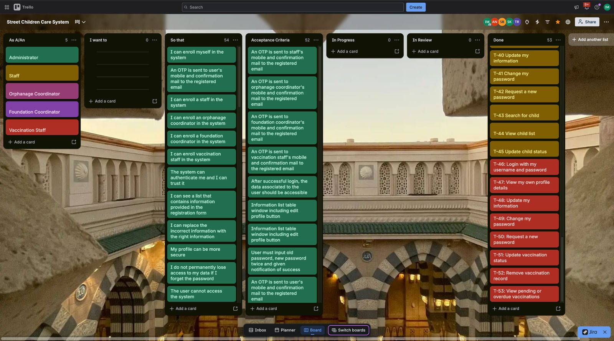
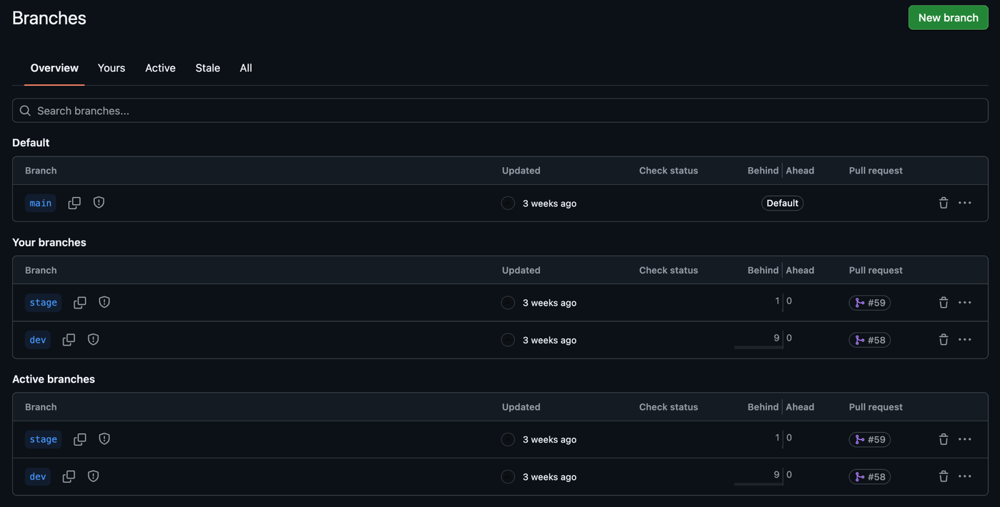
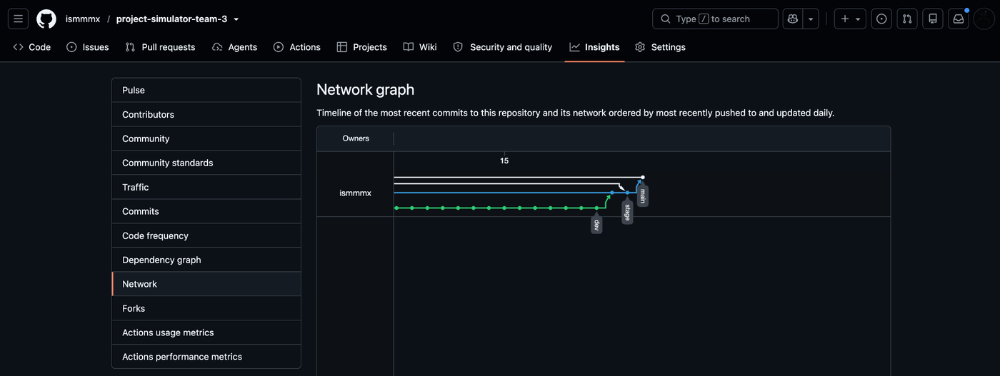
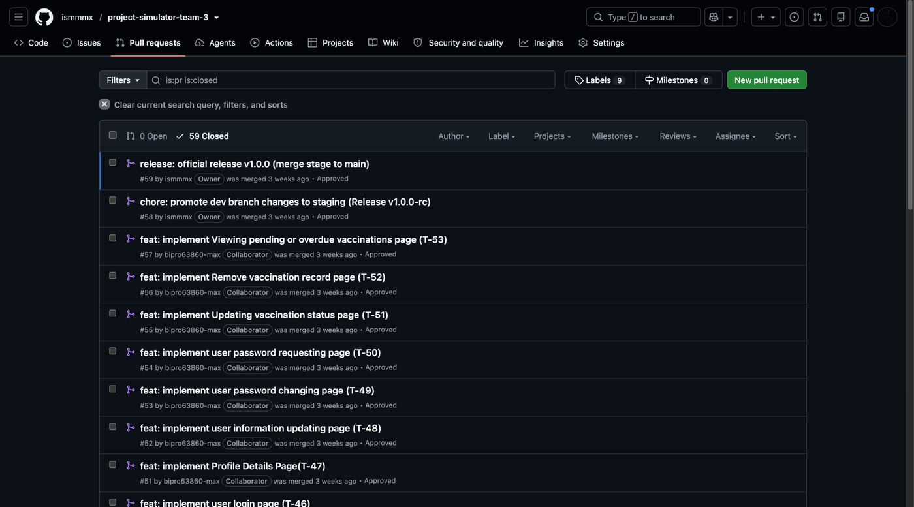
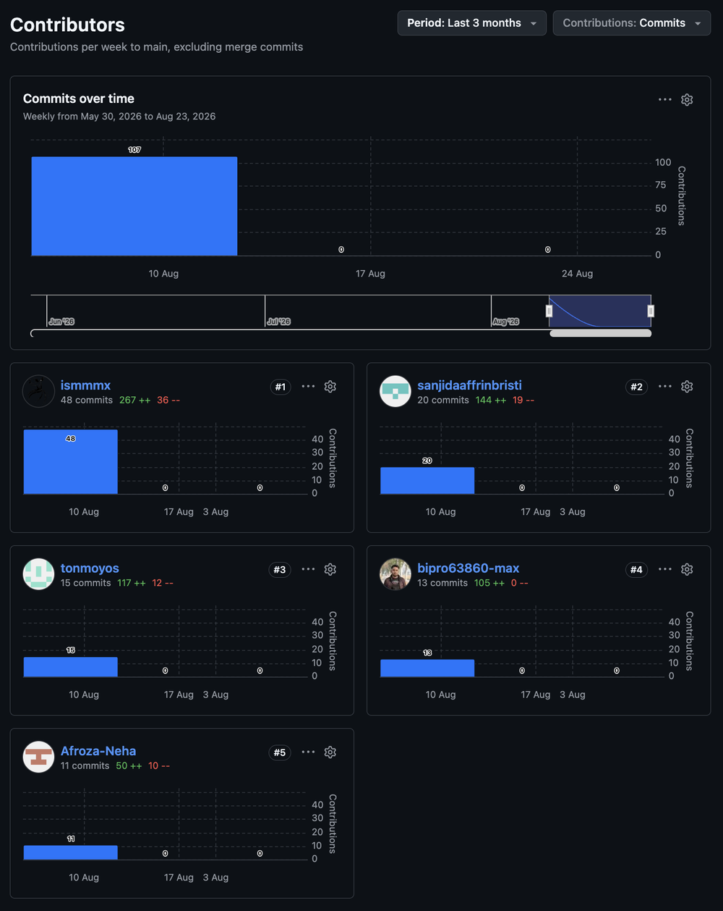

# Project Management

## Trello board

**Board:** [Street Children Care System](https://trello.com/b/yeTZYjen/street-children-care-system)

The board combines user stories and workflow states:

| List | Purpose |
|---|---|
| As A/An | The five user roles |
| I want to / So that | Story goals and benefits |
| Acceptance Criteria | Conditions for accepting each story |
| In Progress · In Review · Done | Task workflow |

The snapshot in the project report shows **53 cards (T-1 to T-53) in the Done list** and none in progress or review. Task IDs from the cards are referenced in pull-request titles (for example T-46 to T-53).

*Trello board snapshot from the project report (Figure 5.5).*

## Git workflow

| Branch | Purpose |
|---|---|
| `main` | Stable branch; default; receives the release pull request |
| `stage` | Pre-release branch used for the release candidate |
| `dev` | Integration branch for merged feature work |
| feature branches | Short-lived branches per Trello task, deleted after merge |

Flow: task branch → pull request into `dev` → release candidate PR into `stage` (PR #58) → official release PR into `main` (PR #59, v1.0.0).

Commit and pull-request titles follow a `type: description (T-n)` pattern, for example `feat: implement Viewing pending or overdue vaccinations page (T-53)`.

| Branches | Network graph |
|---|---|
|  |  |

*Repository evidence from the project report (Figures 5.1–5.3), captured before the repository was renamed.*

## Contributions

*GitHub Contributors graph, 30 May – 23 August 2026 (Figure 5.4). Commits per contributor: 48, 20, 15, 13 and 11 (107 in total).*

## XP practices recorded in the project report

- Weekly iterations with small, incremental delivery
- Trello task tracking (To Do → In Progress → In Review → Done)
- Pull-request code review before merging
- Collective code ownership and continuous integration
- Flexibility for changing requirements
- Sustainable pace: maximum 40 working hours per week
- Shared documents and regular team communication
